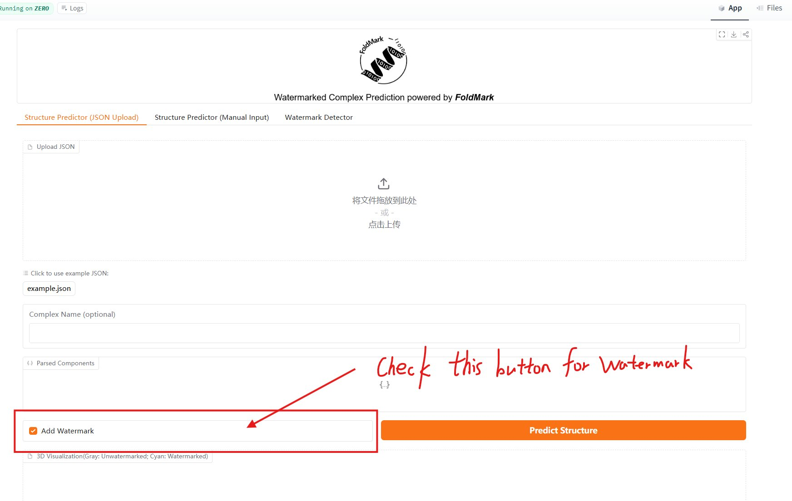
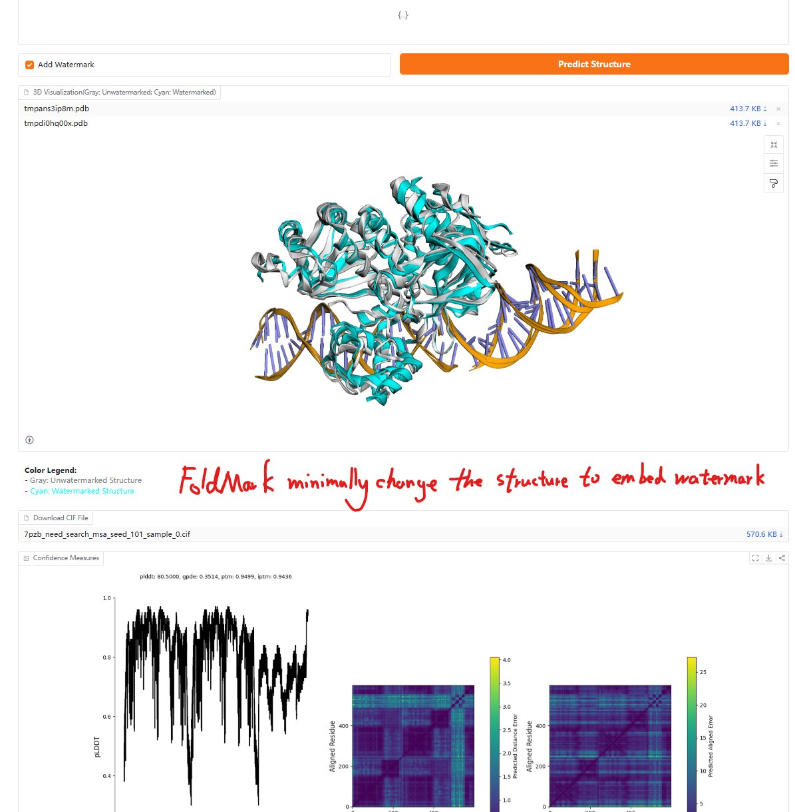

# FoldMark: Safeguarding Protein Structure Generative Models with Distributional and Evolutionary Watermarking
<div align=center></div>

<div align=center>

[](https://huggingface.co/spaces/Zaixi/FoldMark)
[](https://www.biorxiv.org/content/10.1101/2024.10.23.619960v7)
[](https://x.com/ZaixiZhang/status/1937877504842158503)

</div>

## 📰 Media Coverage
- **Science**: [Built-in safeguards might stop AI from designing bioweapons](https://www.science.org/content/article/built-safeguards-might-stop-ai-designing-bioweapons)
- **Nature Biotechnology**: [Watermarking generative AI for protein structure](https://www.nature.com/articles/s41587-025-02650-8)
- **Princeton AI Lab**: [Deep Dive Series: Building Biosecurity Safeguards into AI for Science](https://blog.ai.princeton.edu/2025/06/26/deep-dive-series-building-biosecurity-safeguards-into-ai-for-science/)


## 🌟 Try Our Demo!

We've created an interactive demo on Hugging Face Spaces where you can:
- Input protein sequences and get watermarked structure predictions
- Compare watermarked vs. non-watermarked structures
- Visualize the differences in 3D
- Pretrained Checkpoints and Inference code

[Try the Demo →](https://huggingface.co/spaces/Zaixi/FoldMark)


## 🚀 Overview

FoldMark is a first-of-its-kind watermarking strategy designed to provide essential biosecurity safeguards for generative protein models against dual-use risks. It:
- **Balances Performance and Quality:** Employs distributional and evolutionary principles to embed watermarks while maintaining high-fidelity protein structures.
- **High Bit Accuracy:** Achieves over 95% watermark bit accuracy at 32 bits with minimal impact on structural integrity (maintaining >0.9 scTM scores).
- **Broad Compatibility:** Works seamlessly with leading models, including AlphaFold3, ESMFold, RFDiffusion, and RFDiffusionAA.
- **Robust User Tracing:** Capable of successfully tracing the source of a generated protein back to one of up to 1 million users.
- **Wet Lab Validated:** Successfully tested on redesigned EGFP and CRISPR-Cas13, which showed wildtype-level function (98% fluorescence, 95% editing efficiency) and >90% watermark detection, proving its practical utility.


## 📊 Results

### Structure Prediction with Watermarking
<div align=center>

</div>

### De Novo Protein Structure Design with Watermarking
<div align=center>

</div>

## 🛠️ Installation

```bash
# Create and activate conda environment
conda env create -f foldmark.yml
conda activate fm

# Install torch-scatter
pip install torch-scatter -f https://data.pyg.org/whl/torch-2.0.0+cu117.html

# Install local package
pip install -e .
```

## 📊 Training Pipeline

### Data Setup
1. Download preprocessed SCOPe dataset (~280MB):
   [Download Link](https://www.dropbox.com/scl/fi/b8l0bqowi96hl21ycsmht/preprocessed_scope.tar.gz?rlkey=0h7uulr7ioyvzlap6a0rwpx0n&dl=0)
2. Extract the data:
   ```bash
   tar -xvzf preprocessed_scope.tar.gz
   rm preprocessed_scope.tar.gz
   ```

### Training Steps
1. Pretrain the model:
   ```bash
   python -W ignore experiments/pretrain.py
   ```
2. Finetune with watermarking:
   ```bash
   python -W ignore experiments/finetune.py
   ```
## 🔬 Wet Lab Verifications on GFP and Cas13 Redesign
<div align=center>

</div>

## 📖 Reproduction Tutorials

Step-by-step scripts to reproduce the wet-lab watermarking experiments are
provided in [`tutorials/`](tutorials/), covering **four proteins**: two
fluorescent / nuclease targets (eGFP, Cas13) and two enzymes (DHFR, TEV).

Each protein has **three scripts** covering the full pipeline:

| Step | Script | Description |
|------|--------|-------------|
| 1 | `step1_watermarked_structure_prediction.py` | Run FoldMark-Protenix to obtain a watermarked backbone |
| 2 | `step2_proteinmpnn_inverse_folding.py` | Partial inverse folding with ProteinMPNN (100 sequences, T = 0.1) |
| 3 | `step3_esm2_ranking.py` | Score with ESM2-650M and export top constructs for synthesis |

**eGFP (PDB 4EUL)** — design regions: residues 15–40 and 160–190 (surface-exposed loops).
Chromophore residues and proton-wire residues are fixed. 12 constructs synthesised;
98% fluorescence and >90% watermark bit accuracy.

**Cas13 (PDB 7VTI, apo/inactive state)** — design region: residues 258–325 (helical lid).
HEPN catalytic dyads are fixed. Top constructs showed 95% editing efficiency and
over 90% watermark bit accuracy.

**DHFR (PDB 4P66)** — design region: residues 150–157 (C-terminal tail). The Met20
gating loop, Asp27 and the folate-binding cleft are fixed.

**TEV protease (PDB 1LVM)** — two sparse carrier groups selectable with `--group a|b`:
group A uses residues 11–25 plus alternating positions of 178–197; group B uses
11–25 plus 1-in-4 positions of the engineered C-terminal extension 222–241. The
His46 / Asp81 / Cys151 catalytic triad is fixed.

For both enzymes, **2 out of 3 top-ranked variants retained activity equivalent to
the corresponding wildtype enzyme**, with >90% watermark bit accuracy.

```bash
# Quick start (run from the FoldMark HuggingFace Space root after installation)
python tutorials/egfp/step1_watermarked_structure_prediction.py
python tutorials/egfp/step2_proteinmpnn_inverse_folding.py --mpnn_dir ./ProteinMPNN
python tutorials/egfp/step3_esm2_ranking.py

# Enzymes
python tutorials/dhfr/step2_proteinmpnn_inverse_folding.py --mpnn_dir ./ProteinMPNN
python tutorials/tev/step2_proteinmpnn_inverse_folding.py  --mpnn_dir ./ProteinMPNN --group a
```

## 🔎 Confidence-Weighted Decoding

The decoder emits a **per-residue** code together with a **per-residue
confidence**, and pools the codes by a masked softmax over the confidences
rather than averaging them uniformly:

```
z_i = code_extractor(h_i)                 per-residue code      [B, N, K]
a_i = confidence_head(h_i)                per-residue confidence [B, N]
w   = softmax_i(a_i / T)                  over valid residues only
code = Σ_i w_i · z_i                      pooled message         [B, K]
```

Configured in [`configs/base.yaml`](configs/base.yaml):

```yaml
encoder_decoder:
  confidence_weighted_decoding: true   # false recovers unweighted pooling
  confidence_temperature: 1.0          # lower concentrates weight on confident residues
```

`Decoder.forward(..., return_confidence=True)` additionally returns the
normalised per-residue weights, so the confidence distribution can be inspected
or visualised along the chain.

Two properties worth noting:

- **The confidence head is zero-initialised.** All logits start equal, the
  softmax is uniform, and the pooled code is then *exactly* the masked mean.
  Confidence weighting is a strict generalisation of unweighted pooling, so
  training resumes from precisely where an unweighted checkpoint left off.
  Checkpoints predating the head load through `FlowModule.on_load_checkpoint`,
  which fills in the missing keys with zeros and leaves every other mismatch
  reported as usual.
- **Both pooling paths respect `res_mask`.** The earlier implementation used a
  plain `.mean(dim=1)` over the padded length; since the code extractor has a
  bias, padded positions contributed that bias and the divisor was the padded
  length rather than the true one. Padding is now excluded from the code, from
  the softmax normaliser, and from the divisor.

## 🧪 Supplementary Experiments

Additional analyses accompanying the manuscript live in
[`experiments_revision/`](experiments_revision/). Each subdirectory is
self-contained, follows the same numbered `stepN_*.py` layout as `tutorials/`,
and ships its own `README.md` and `requirements.txt`.

| Directory | What it does |
|-----------|--------------|
| [`chen_et_al_comparison/`](experiments_revision/chen_et_al_comparison) | FoldMark vs. sequence-level protein watermarking (Chen et al.) under a matched ProGen2 generation and evaluation pipeline; bit recovery accuracy and scTM across sequence lengths, with paired Wilcoxon signed-rank tests |
| [`robustness_postprocessing/`](experiments_revision/robustness_postprocessing) | Watermark persistence under Amber relaxation, Rosetta FastRelax and NGK loop modeling, in protein–ligand and protein–antibody bound states |
| [`user_tracing_codebook/`](experiments_revision/user_tracing_codebook) | Million-user 32-bit codebook from an extended BCH [32, 21, 6] construction, attribution under decoding errors, calibration of the decoder null, and an end-to-end encode → fold → detect → attribute round trip |
| [`inverse_fold_refold/`](experiments_revision/inverse_fold_refold) | Watermark survival through ProteinMPNN inverse folding followed by clean re-folding with Protenix, ESMFold or AlphaFold3 |

Two conventions hold throughout: statistical tests report the test used, n, the
effect size, and a multiple-comparison-corrected p-value; and figure scripts read
their numbers from the upstream step's CSV rather than hard-coding summary
statistics, so every panel traces back to the data that produced it.

## Quick start on HuggingFace

The demo has three tabs: **Structure Predictor (JSON Upload)**, **Structure Predictor (Manual Input)**, and **Watermark Detector**.

| | |
|---|---|
|  |  |
| **1.** Upload a sequence JSON (or type manually) and check **Add Watermark** | **2.** View the overlaid 3D result and download the watermarked CIF |

Upload the downloaded CIF to the **Watermark Detector** tab to verify the embedded signal.

See the full step-by-step guide with all screenshots: [`tutorials/huggingface_tutorial/`](tutorials/huggingface_tutorial/)

## 📝 Citation

If you find this work helpful, please cite our paper:

```bibtex
@article{zhang2024foldmark,
  title={FoldMark: Protecting Protein Generative Models with Watermarking},
  author={Zhang, Zaixi and Jin, Ruofan and Fu, Kaidi and Cong, Le and Zitnik, Marinka and Wang, Mengdi},
  journal={bioRxiv},
  pages={2024--10},
  year={2024},
  publisher={Cold Spring Harbor Laboratory}
}
```

## 🙏 Acknowledgments

We thank the following open-source projects for their valuable contributions:
- [Protenix](https://github.com/bytedance/Protenix)
- [FrameFlow](https://github.com/microsoft/protein-frame-flow)
- [FrameDiff](https://github.com/jasonkyuyim/se3_diffusion)
- [RFDiffusion](https://github.com/RosettaCommons/RFdiffusion)
- [Boltz-1](https://github.com/openfold/boltzmann)
- [Chai-1](https://github.com/chaidiscovery/chai-lab)
- [RFDiffusionAA](https://github.com/baker-laboratory/rf_diffusion_all_atom)
- [WaDiff](https://github.com/rmin2000/WaDiff)
- [AquaLoRA](https://github.com/Georgefwt/AquaLoRA)
- [openfold](https://github.com/aqlaboratory/openfold)
- [ProteinWatermark](https://github.com/poseidonchan/ProteinWatermark)
- [ProteinMPNN](https://github.com/dauparas/ProteinMPNN)


## 📄 License

This project is licensed under the MIT License - see the LICENSE file for details.


